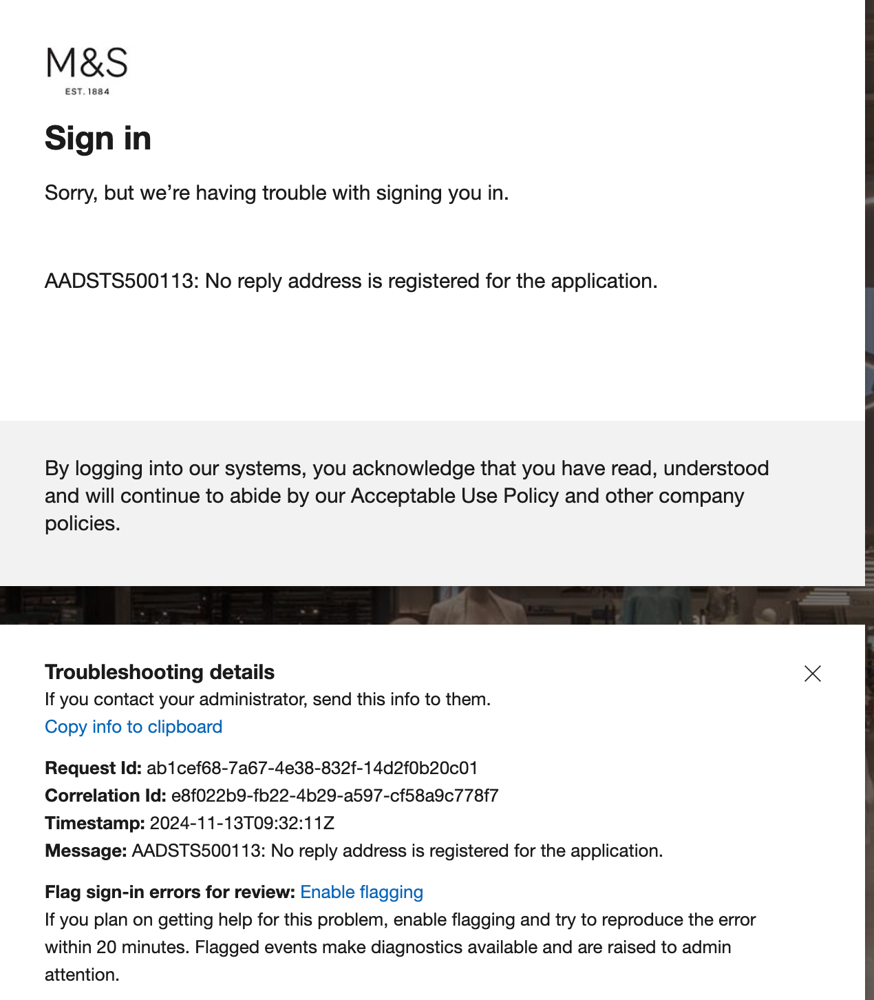
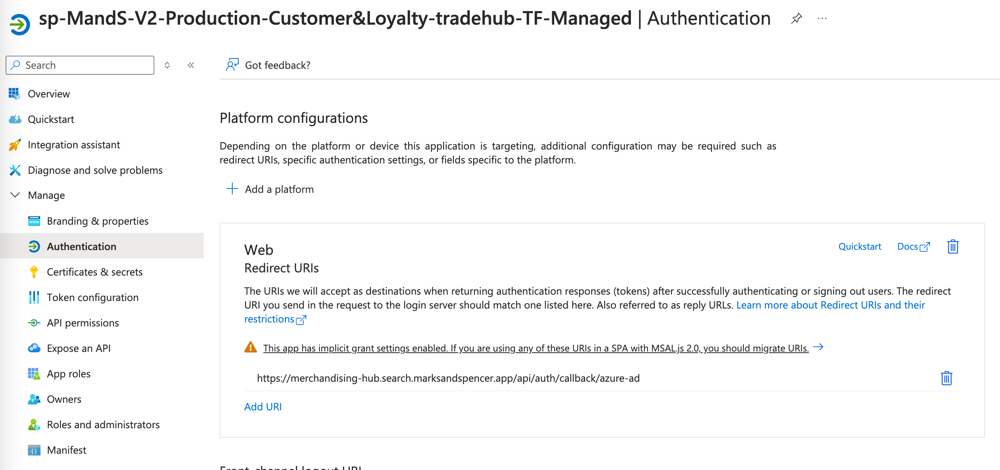

# Run book

## Overview

### Business overview

The application provides a UI for configuring results for Search Results Pages (SRPs) and Product Listing Pages (PLPs).

### Technical overview

This application is responsible for:

- Updating data provided by [search-service](https://github.com/DigitalInnovation/search-service)
- Previewing PLPs and SRPs

It is deployed to Azure App Service.

#### Technologies

- [NextJS](https://nextjs.org/)
- [Typescript](https://www.typescriptlang.org/)

#### Dependencies

- [search-service](https://github.com/DigitalInnovation/search-service)
  failure of the search service will prevent use of the application, as apis are not cached

#### Deployment

The application is deployed by the [main release workflow](../.github/workflows/release.yml) when changes reach `main`, or by the [hotfix release workflow](../.github/workflows/hotfix.yml) when changes reach `hotfix`. The [PR validation workflow](../.github/workflows/pr-validate-and-deploy.yml) validates pull requests; it does not deploy the application.

## Service owners

| Name                 | Contact                                                                                                                                                                                                                                  |
| -------------------- | ---------------------------------------------------------------------------------------------------------------------------------------------------------------------------------------------------------------------------------------- |
| Search and Sort Team | [Teams link](https://teams.microsoft.com/l/channel/19%3Acd7050274735499eb5b50a6be31eaf33%40thread.tacv2/%5BSquad%5D%20Search%20-%20Incidents?groupId=09be67e3-2208-45f2-9eaf-41d6c22743bb&tenantId=bd5c6713-7399-4b31-be79-78f2d078e543) |
|                      | [E-mail](grp-search-and-sort@mnscorp.onmicrosoft.com)                                                                                                                                                                                    |

### Engineering Manager:

Toyin Butler

### Engineers:

James Winfield  
Nikolay Gushchin

### Product Manager:

Daniel Mountford

## System overview

### Operating hours

Trading Hub is available for use 24 hours a day, it is supported 9am - 6pm Monday to Friday.

#### Azure

- [prod eun](https://portal.azure.com/#@mnscorp.onmicrosoft.com/resource/subscriptions/7f2ff24f-150e-4686-a521-76c5fe21e6e2/resourceGroups/prod-trading-hub-v1-eun-layer3-rg/providers/Microsoft.Web/sites/prod-trading-hub-v1-eun-layer3-app/appServices)

- [prod euw](https://portal.azure.com/#@mnscorp.onmicrosoft.com/resource/subscriptions/7f2ff24f-150e-4686-a521-76c5fe21e6e2/resourceGroups/prod-trading-hub-v1-euw-layer3-rg/providers/Microsoft.Web/sites/prod-trading-hub-v1-euw-layer3-app/appServices)

- [dev eun](https://portal.azure.com/#@mnscorp.onmicrosoft.com/resource/subscriptions/26521dda-e1c7-4d57-abae-abe1ab30b4fc/resourceGroups/dev-trading-hub-v1-eun-layer3-rg/providers/Microsoft.Web/sites/dev-trading-hub-v1-eun-layer3-app/appServices)

- [PIM access list](https://portal.azure.com/#view/Microsoft_AAD_IAM/GroupDetailsMenuBlade/~/Members/groupId/99c29c95-2983-4829-bbac-82ebb28288d3)

## Configuration

### Merchandising Hub Access

Users need the required Merchandising Hub app roles, assigned either directly or through an approved AD group. See the [current group list and assignment instructions](./user-access-managment.md).

## Monitoring

### Logs - Dynatrace

See [Dynatrace documentation](https://github.com/DigitalInnovation/trading-hub/blob/main/docs/dynatrace.md)

### Troubleshooting

In the event of an outage the most likely causes are:

- Failed deployment
- API error from search service
- User is not authorised to use the Merchandising Hub
- Azure client secret has expired and needs rotating

#### Scenario: In case of users not being able to sign in after being signed out, it could be that the redirect url is missing from Azure.

This is the error that they would receive:



This can be corrected by adding it back to the Authentication page:



The redirect for prod is: https://merchandising-hub.search.marksandspencer.app/api/auth/callback/azure-ad
For dev: https://dev-merchandising-hub.search.marksandspencer.app/api/auth/callback/azure-ad
For localhost: http://localhost:3000/api/auth/callback/azure-ad

#### Scenario: Infrastructure deployment fails because a service principal secret expired

> The provided client secret keys for app '\*\*\*' are expired. Visit the Azure portal to create new keys for your app

The application release workflows authenticate to Azure using OIDC. `SP_PASSWORD` is used by the infrastructure/Terraform workflows, not by the application deployment workflow. If this error occurs in an infrastructure workflow, identify the service principal using `SP_CLIENT_ID` in the matching GitHub Actions environment (`Nonprod` or `Prod`), then ask an authorized owner to rotate its credential and update that environment's `SP_PASSWORD` secret. Do not use the app-registration links for user sign-in to identify this infrastructure principal. For the application's Entra client secret, follow the [secret rotation guide](./secret-rotation.md).

#### Scenario: Production smoke tests fail to authenticate

If production Playwright smoke tests fail at sign-in, rotate/reset the test account credentials used by the workflow secrets:

- `PROD_TEST_USER`
- `PROD_TEST_USER_PASSWORD`

Follow the full procedure in [secret rotation guidance](./secret-rotation.md#prod-smoke-test-user-password-reset).

### Hotfix Release Process

Create your branch from the [hotfix branch](https://github.com/DigitalInnovation/trading-hub/tree/hotfix).

Make your necessary changes, commit and push the code.

Create a pull request, with the base branch as [hotfix branch](https://github.com/DigitalInnovation/trading-hub/tree/hotfix).

If there is a code freeze, or there are other unreleased changes on the main branch, do not merge in the main branch, and do not follow the "resolve conflicts" process on your pull request.

Follow the repository's current review and branch-protection requirements. Production deployment approval, if required, is controlled by the GitHub environment settings.

Merge your pull request. This will trigger the [Hotfix Release workflow](https://github.com/DigitalInnovation/trading-hub/blob/main/.github/workflows/hotfix.yml).

This will deploy to dev so that you can test your fix.

The workflow deploys the change to production after the dev deployment. Complete any approval required by the production GitHub environment.

After the fix is released, make sure the same fix is included in `main`. Do not merge the entire `hotfix` branch into `main` if it contains other unreleased changes. Instead, create a branch from the latest `main`, cherry-pick only the hotfix commit(s), and open a pull request targeting `main`:

```bash
git switch main
git pull --ff-only
git switch -c hotfix/<short-description>
git cherry-pick <hotfix-commit-sha>
```

Resolve any conflicts carefully and run the normal PR checks. If the fix cannot be cleanly cherry-picked, coordinate with the maintainers to apply it to `main` without bringing in unrelated changes. A successful normal release syncs `main` into `hotfix`; it does not sync hotfix changes back into `main`.
